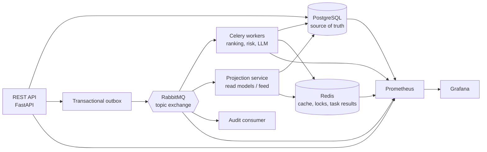

# SignalRank: проектный план

## 1. Идея

**SignalRank** — учебная платформа, моделирующая систему доверия, риска и распространения контента в профессиональной социальной сети.

Она не является клоном или ботом для LinkedIn: не использует скрейпинг, автоматические публикации, реальные аккаунты или внутренние алгоритмы LinkedIn. Вместо этого система работает на синтетических пользователях и событиях. Это позволяет безопасно исследовать event-driven архитектуру, очереди, асинхронные расчёты, мониторинг и нагрузку.

Цель системы: принять активность пользователя, асинхронно оценить её, пересчитать рейтинг автора, решить, как широко распространять контент, и при необходимости отправить действие на проверку.

## 2. Доменные сущности и сценарии

### События активности

- `post_published`
- `reaction_added`
- `comment_added`
- `repost_created`
- `profile_viewed`
- `content_moderated`

### Оценки

Для пользователя и контента система вычисляет три объяснимых показателя:

- **Trust score** — насколько аккаунт выглядит устойчивым и добросовестным.
- **Distribution score** — насколько активно контент стоит включать в рекомендации и ленты.
- **Risk score** — вероятность подозрительной активности.

Пример модели:

```text
distribution = trust × content_quality × relevance × recency
risk = burstiness + duplication + coordination + low_account_trust
```

Каждый расчёт сохраняет не только итоговый балл, но и вклады факторов, версию правил/модели и время вычисления. Это позволяет объяснять результат через API и дашборды.

### Решения

- `allow` — обычное распространение;
- `limit` — ограниченная дистрибуция;
- `review` — отправка в очередь ручной проверки;
- `block` — используется только в симуляции и при явно высоком риске.

## 3. Архитектура



### Рекомендуемый стек

| Компонент | Технология | Назначение |
|---|---|---|
| API | Python, FastAPI | REST API, OpenAPI, валидация запросов |
| Основная БД | PostgreSQL | Источник истины и аналитические запросы |
| Брокер | RabbitMQ | Доменные события и маршрутизация между сервисами |
| Фоновые задачи | Celery | Ранжирование, риск-анализ, LLM, периодические задачи |
| Кэш и backend задач | Redis | Кэш ленты, rate limiting, locks, статусы долгих задач |
| Метрики | Prometheus | Сбор инфраструктурных и прикладных метрик |
| Визуализация | Grafana | Дашборды и алерты |
| Локальный запуск | Docker Compose | Воспроизводимое окружение |

## 4. Границы сервисов

Не нужно начинать с большого числа микросервисов. Достаточно трёх deployable-компонентов.

### `api`

- принимает REST-запросы;
- создаёт пользователей, контент и события активности;
- в одной транзакции PostgreSQL пишет доменную сущность и запись в outbox;
- отдаёт профиль, текущие score, ленту и очередь review;
- экспортирует HTTP- и бизнес-метрики.

### `worker`

Celery worker и Celery Beat:

- пересчитывает score пользователя;
- анализирует риск;
- строит или инвалидирует кэш кандидатов ленты;
- запускает LLM-анализ публикации;
- запускает периодические задачи: очистку кэша, reconciliation outbox, пересчёт агрегатов.

### `projection-service`

Независимый consumer RabbitMQ на `aio-pika`:

- читает доменные события напрямую, а не через Celery;
- строит read-модели для ленты и review-очереди;
- обновляет агрегаты;
- демонстрирует разницу между доменным событием и Celery-командой.

## 5. RabbitMQ и доставка сообщений

### Топология

Один topic exchange: `social.events`.

Пример routing keys:

```text
activity.posted
activity.reacted
activity.reposted
content.moderated
score.changed
risk.decision_made
```

Основные очереди:

| Очередь | Consumer | Назначение |
|---|---|---|
| `ranking` | Celery | Расчёт trust/distribution/risk |
| `llm` | Celery | Медленные LLM-задачи |
| `projection` | projection-service | Построение read-моделей |
| `audit` | audit consumer | Аудит и диагностика |
| `*.dlq` | ручная обработка / replay tool | Необработанные сообщения |

### Надёжность

- Использовать **transactional outbox**: событие и бизнес-изменение фиксируются одной транзакцией PostgreSQL.
- Добавлять в каждое сообщение `event_id`, `occurred_at`, `schema_version`, `correlation_id`.
- Реализовать идемпотентность: таблица `processed_events` с уникальным ключом `(consumer_name, event_id)`.
- Считать гарантию доставки как **at-least-once**, а не exactly-once.
- Использовать retry с backoff; исчерпанные сообщения направлять в DLQ.
- Сделать небольшую CLI-команду для безопасного replay событий из DLQ.

## 6. Роль Redis

Redis нужен не формально, а для нескольких независимых задач:

- кэш топ-N кандидатов ленты пользователя;
- ограничение частоты запросов и публикаций;
- короткоживущие distributed locks;
- Celery result backend для задач, за статусом которых следит API;
- кэш LLM-результатов по хешу контента.

Для каждого назначения стоит использовать префикс ключей:

```text
feed:{user_id}
rate:{user_id}:{minute}
lock:ranking:{user_id}
llm:{content_hash}:{prompt_version}
```

## 7. PostgreSQL и объём данных

### Основные таблицы

- `users`
- `content`
- `activity_events` — append-only поток действий
- `outbox_events`
- `user_score_snapshots`
- `risk_decisions`
- `review_cases`
- `processed_events`

### Работа с 10–20 ГБ

`activity_events` следует партиционировать по месяцу. Для экспериментов с производительностью:

- использовать BRIN-индекс по времени;
- сравнить с B-tree индексами, например `(actor_id, occurred_at DESC)`;
- использовать `COPY` для первичного seed набора данных;
- анализировать планы через `EXPLAIN (ANALYZE, BUFFERS)`;
- создавать материализованные представления для дневных агрегатов;
- измерять влияние JSONB, индексов и партиций на размер БД.

Не стоит задавать число строк заранее: нужный объём достигается фактическим измерением после выбора размера payload и индексов.

## 8. Генератор данных и нагрузочные профили

Генератор должен производить не просто равномерно случайные события, а разные поведенческие профили:

- обычные пользователи;
- активные авторы;
- новые аккаунты;
- спамеры с burst-нагрузкой;
- группы с синхронными реакциями и репостами;
- пользователи, которые публикуют повторяющийся контент.

Режимы запуска:

1. **Seed** — загрузка большого набора через `COPY`.
2. **Live** — события проходят через API и RabbitMQ.
3. **Replay** — воспроизведение исторических событий с регулируемой скоростью.
4. **Failure scenario** — временная недоступность RabbitMQ, Redis или worker с последующей проверкой retry и lag.

## 9. API первого вертикального среза

```text
POST /v1/users
POST /v1/content
POST /v1/activities
GET  /v1/users/{user_id}/score
GET  /v1/users/{user_id}/feed
GET  /v1/review-cases
POST /v1/review-cases/{case_id}/resolve
POST /v1/simulations/run
GET  /metrics
```

Первый полезный сценарий:

1. Создать пользователя и публикацию.
2. Записать `post_published`.
3. Сохранить событие в outbox.
4. Опубликовать его в RabbitMQ.
5. Запустить Celery-пересчёт score.
6. Построить проекцию фида отдельным consumer.
7. Увидеть метрики, trace/correlation ID и изменение score.

## 10. LLM-интеграция

LLM — вторичный сигнал, а не автономный модератор.

Celery-задача `analyze_content` получает публикацию и возвращает JSON по Pydantic-схеме:

```json
{
  "language": "ru",
  "topics": ["backend", "observability"],
  "quality_score": 0.71,
  "spam_probability": 0.08,
  "duplicate_probability": 0.14,
  "explanation": "..."
}
```

Требования:

- structured output и строгая валидация;
- `prompt_version` и `model_version` в результате;
- кэширование по хешу контента;
- fallback на детерминированные правила при ошибке провайдера;
- synthetic ground truth для простого evaluation;
- LLM никогда не принимает бан-решение самостоятельно.

На первом этапе достаточно абстракции `LLMProvider` и mock-провайдера в тестах. Реального провайдера можно подключить позднее.

## 11. Мониторинг и алертинг

### Источники метрик

- FastAPI: HTTP request count, latency, status code, in-progress requests.
- Celery/Flower: workers, задачи, длительность, retries, failures.
- RabbitMQ: rate публикаций, depth очередей, ready/unacked, consumers, memory.
- Redis: memory, evictions, connections, hit rate.
- PostgreSQL: connections, locks, slow queries, размер БД и партиций.
- Приложение: lag обработки событий, pending outbox, решения risk engine, LLM latency и стоимость.

RabbitMQ предоставляет встроенный Prometheus plugin `rabbitmq_prometheus` и готовые Grafana-дашборды. Celery документирует интеграцию Prometheus через Flower. Для Redis можно использовать `redis_exporter`, а для FastAPI — `prometheus-fastapi-instrumentator`.

### Пользовательские метрики

```text
domain_events_published_total
event_processing_lag_seconds
outbox_pending_events
ranking_calculation_duration_seconds
risk_decisions_total
celery_task_retries_total
llm_requests_total
llm_request_duration_seconds
feed_cache_hit_ratio
```

### Дашборды Grafana

1. **Platform overview** — RPS, p95 API latency, ошибки, event lag, worker availability.
2. **RabbitMQ / Celery** — очереди, `ready/unacked`, DLQ, retries, failures, task duration.
3. **Ranking business metrics** — trust/risk distribution, решения `allow/limit/review`, свежесть score.
4. **PostgreSQL / Redis** — slow queries, cache hit rate, память, размер и состояние партиций.

### Первые алерты

- event lag выше допустимого порога;
- очередь растёт при отсутствии активных consumers;
- ненулевая DLQ;
- рост ошибок Celery-задач;
- outbox долго не опустошается;
- Redis близок к `maxmemory` или увеличивается число evictions;
- p95 latency API выше цели.

## 12. Набор демонстраций

Проект должен уметь показывать не только "всё работает", но и диагностируемые сбои:

1. Burst публикаций увеличивает risk score и создаёт review case.
2. RabbitMQ недоступен: события остаются в outbox и публикуются после восстановления.
3. Worker падает во время обработки: повторная доставка не создаёт дубликат результата.
4. Медленная LLM-задача не блокирует обычные ranking-задачи благодаря отдельной очереди.
5. После добавления подходящего индекса аналитический запрос ускоряется; эффект виден в `EXPLAIN ANALYZE` и Grafana.

## 13. Предлагаемая структура репозитория

```text
apps/
  api/
  worker/
  projection_service/
packages/
  domain/
  events/
  scoring/
  persistence/
infra/
  docker-compose.yml
  prometheus/
  grafana/
  dashboards/
tests/
scripts/
  seed_data.py
  replay_events.py
  benchmark.py
docs/
```

## 14. План на 45 часов

| Этап | Оценка |
|---|---:|
| Docker Compose, FastAPI, PostgreSQL, миграции и доменная модель | 6 ч |
| Outbox, RabbitMQ topology и projection consumer | 8 ч |
| Celery, Redis, retry, DLQ и идемпотентность | 7 ч |
| Ranking/risk rules, API ленты и review queue | 7 ч |
| Prometheus, Grafana, exporters, alerts и dashboards | 7 ч |
| Генератор, нагрузочные сценарии, индексы и profiling | 6 ч |
| LLM-анализ и evaluation на synthetic data | 3 ч |
| Тесты, README, ADR и демонстрационные сценарии | 4 ч |

## 15. Не-цели первого релиза

- интеграция с реальным LinkedIn;
- скрейпинг, автопостинг или обход ограничений платформ;
- Kubernetes и production-grade HA-кластер;
- полноценный пользовательский фронтенд;
- десятки микросервисов;
- LLM как единственный источник решений о блокировке.

## 16. Полезные первоисточники

- [Celery: Monitoring and Management Guide](https://docs.celeryq.dev/en/latest/userguide/monitoring.html)
- [RabbitMQ: Monitoring with Prometheus and Grafana](https://www.rabbitmq.com/docs/prometheus)
- [RabbitMQ: Monitoring](https://www.rabbitmq.com/docs/monitoring)
- [redis_exporter](https://github.com/oliver006/redis_exporter)
- [prometheus-fastapi-instrumentator](https://github.com/trallnag/prometheus-fastapi-instrumentator)

